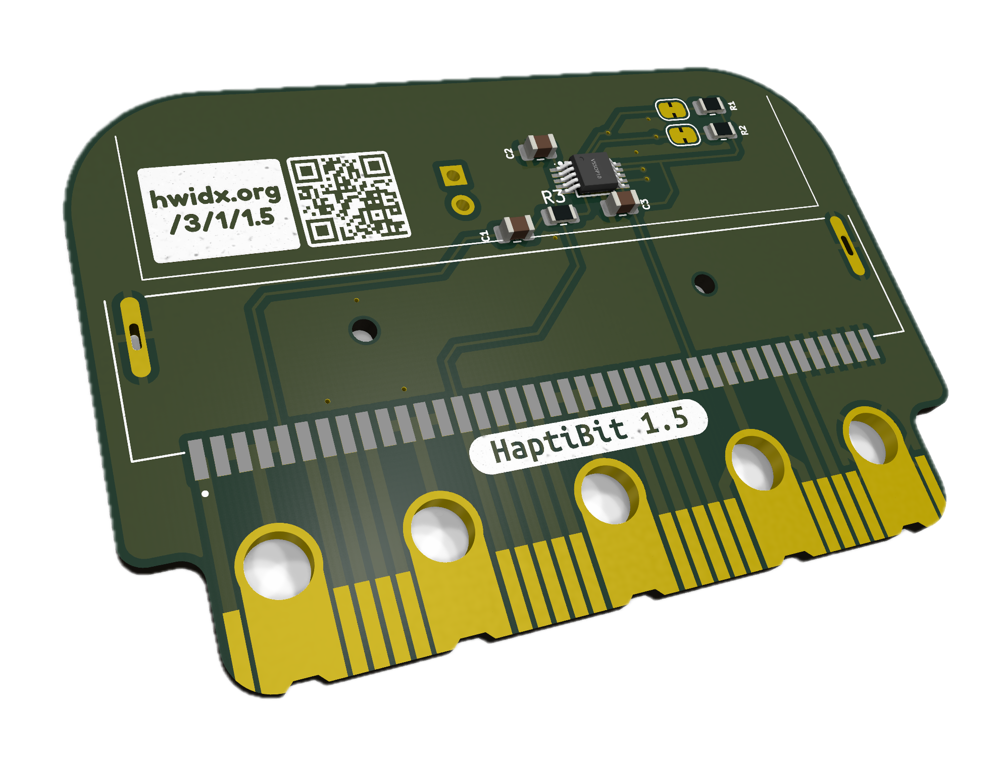
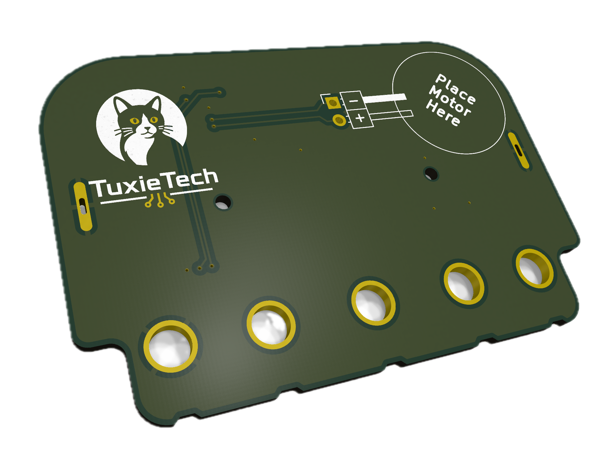
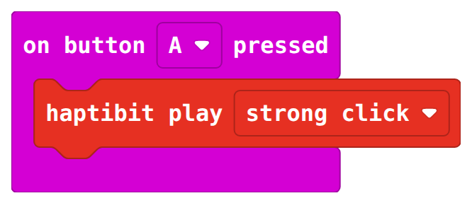
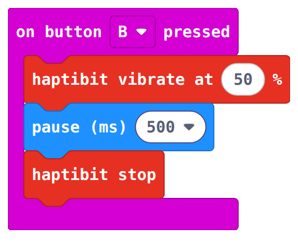
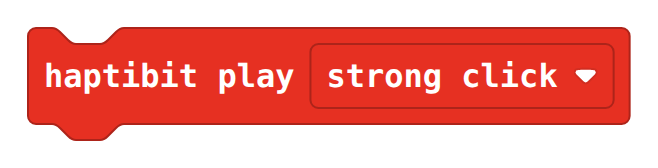
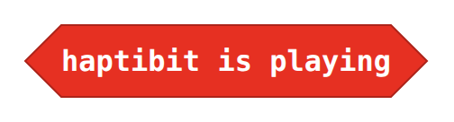
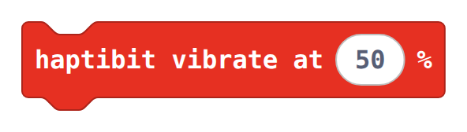
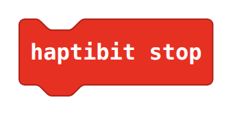
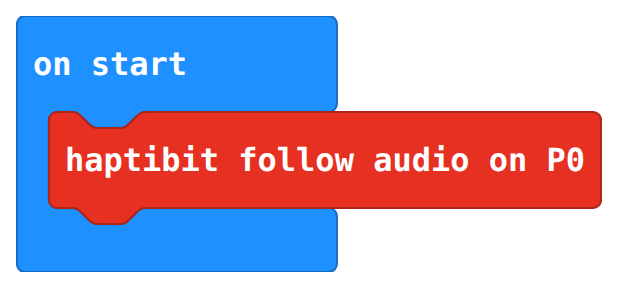

Introducing our buzzing new micro:bit extension, HaptiBit, that brings tactile feedback to your micro:bit.
Create games and projects where everyone engages through touch. Feel the buzz when you’ve pressed a button, completed a task, or met a target.
No need to keep your eyes glued to the screen or struggle listening for a beep in noisy environments.
Get notified by feeling the buzz!
Its effortlessly simple; No soldering; no fiddly wiring. Just slot HaptiBit onto your micro:bit and you're ready to go.
The clever little motor does all the heavy lifting and creates the tactile feedback.

HaptiBit is perfect for those who prefer tactile interaction, ensuring all can participate through its inclusive design.

The HaptiBit is a small micro:bit add-on board that lets you drive a DC motor (for example, a vibration/haptic motor) from a single micro:bit pin.
Solder a small (8mm diameter is ideal) vibration motor to the two `+`/`-` terminals and stick the motor to the back of the board, then plug it onto the edge connector, and you're ready to add buzzes and rumbles to a project.

<x-shelf>
    <x-card>
        <x-photo></x-photo>
        <x-caption>The HaptiBit from the front... </x-caption>
    </x-card>
    <x-card>
        <x-photo></x-photo>
        <x-caption>... and the HaptiBit from the back!</x-caption>
    </x-card>
</x-shelf>

## How it works

HaptiBit uses a **DRV2605L haptic driver** to run the motor with a proper haptics engine. The driver talks to the micro:bit over I2C (P19 / P20), and is enabled by **P8**.
It can play a library of built-in effects (clicks, bumps, buzzes and alerts), or vibrate continuously at any strength from 0 to 100%.

The driver can also turn sound into vibration: connect it to the audio on **P0** and the motor will follow along with your music.

## Using it with MakeCode

Open MakeCode, choose **Extensions**, and add HaptiBit using this repository's URL. You will find the blocks in the red **Haptibit** drawer.

::: view-switch

<x-example>
<div>

### Play an effect

Play one of the built-in haptic effects, here a strong click whenever button A is pressed.

</div>
<div>

::: blocks
<x-photo></x-photo>
:::

::: typescript
```typescript
input.onButtonPressed( Button.A, function () {
    haptibit.playEffect( HapticEffect.StrongClick )
} )
```
:::

</div>
</x-example>

<x-example>
<div>

### Vibrate and stop

Vibrate continuously at a chosen strength, wait, then stop. Here button B buzzes at 50% for half a second.

</div>
<div>

::: blocks
<x-photo></x-photo>
:::

::: typescript
```typescript
input.onButtonPressed( Button.B, function () {
    haptibit.vibrate( 50 )
    basic.pause( 500 )
    haptibit.stop()
} )
```
:::

</div>
</x-example>

## Block reference

| Block | What it does |
| --- | --- |
| :blocks[] :typescript[`haptibit.playEffect( effect )`] | Plays a built-in effect. Waits for any effect already playing, so back-to-back effects all play. |
| :blocks[] :typescript[`haptibit.isPlaying()`] | True while an effect is playing. |
| :blocks[] :typescript[`haptibit.vibrate( percent )`] | Vibrates continuously from 0 (off) to 100. 1 is the weakest strength that moves the motor. |
| :blocks[] :typescript[`haptibit.stop()`] | Stops any vibration. |
| :blocks[] :typescript[`haptibit.followAudio()`] | Vibrates in time with audio on P0 (under **Advanced**). |

### Effects

We provide some basic vibration expresions to play with, but these can easily be chained together to create more complex movements.

- `strong click`, `sharp click` and `soft bump` (each at 100%, 60% and 30%)
- `double click` (100%, 60%)
- `triple click`
- `soft fuzz`
- `strong buzz`
- `alert 750 ms` / `alert 1000 ms`.

## Other Expansion Boards

Because we think that using _all_ the pins on the micro:bit to drive just one motor is a bit limiting, we have included another microbit-style header on the bottom of the HaptiBit, which allows you to plug in other expansions and use them with our board.

This breaks out all the micro:bit pins, so should work just the same as plugging in the micro:bit itself! Try plugging in your favourite extensions and using them together. **As long as they don't also use P8 (or P0, P19 and P20) for something it should all just work!**. You can even reclaim P0 if you don't plan on using the audio functions, as we decouple this pin.

## Older versions

Using a 1.0 board, which switched the motor directly from P8? See the [version 1.0 documentation](version-1.0/).

## In the media

HaptiBit and TuxieTech have been featured in the press. See [In the media](in-the-media/).
