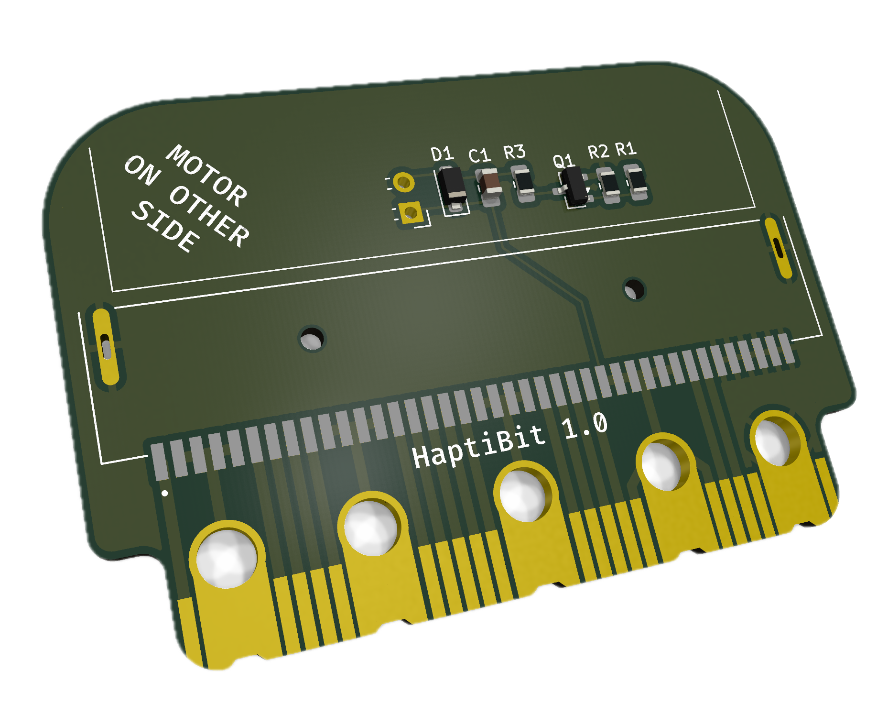
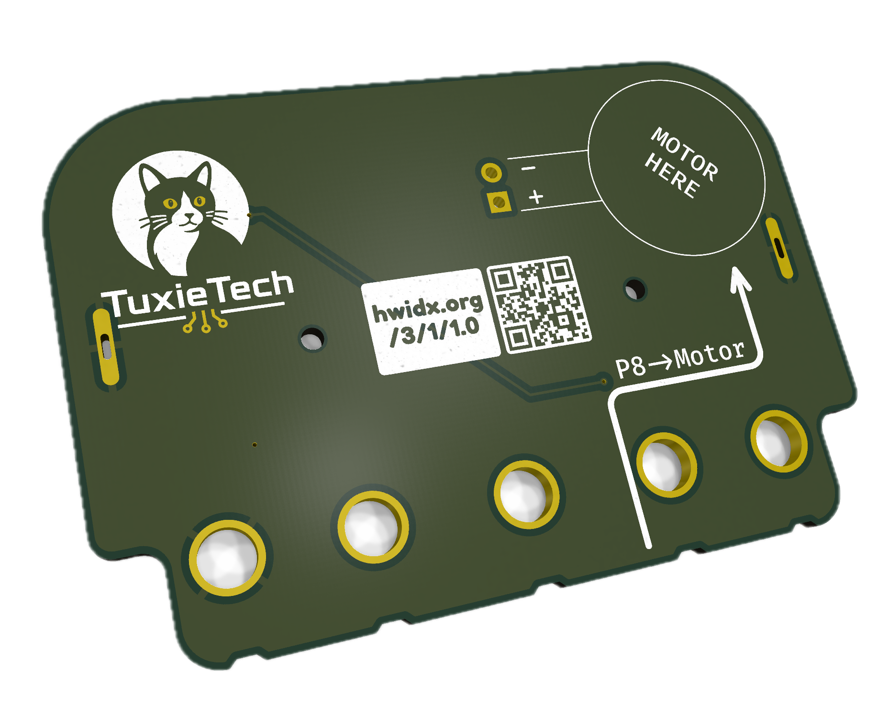
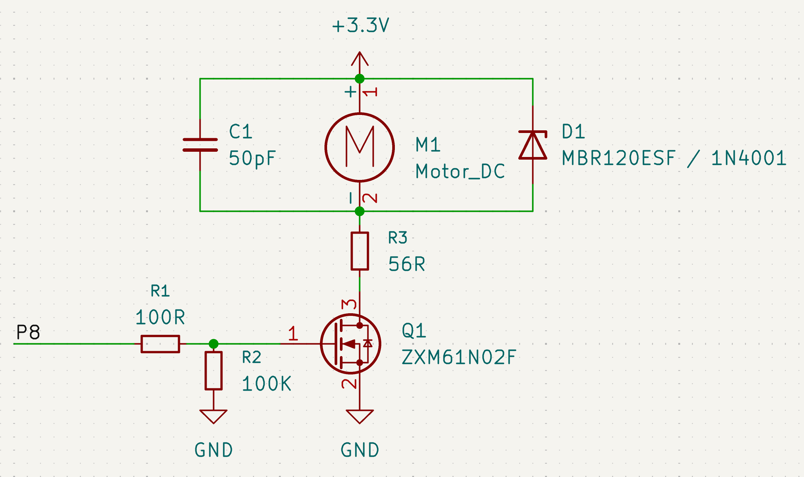
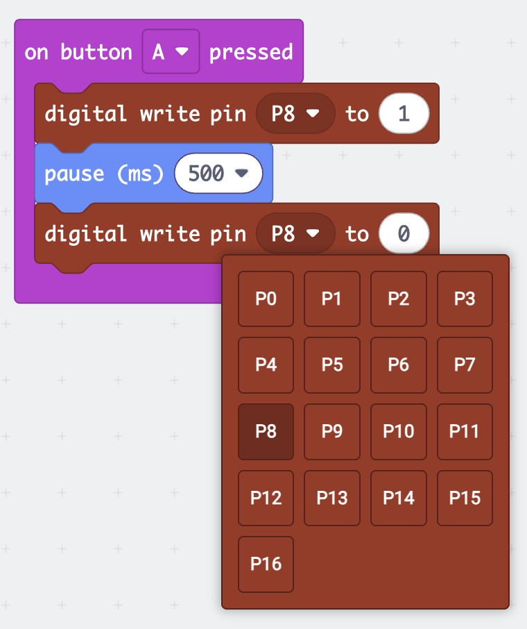

Introducing our buzzing new micro:bit extension, HaptiBit, that brings tactile feedback to your micro:bit.
Create games and projects where everyone engages through touch. Feel the buzz when you’ve pressed a button, completed a task, or met a target.
No need to keep your eyes glued to the screen or struggle listening for a beep in noisy environments.
Get notified by feeling the buzz!
Its effortlessly simple; No soldering; no fiddly wiring. Just slot HaptiBit onto your micro:bit and you're ready to go.
The clever little motor does all the heavy lifting and creates the tactile feedback.

HaptiBit is perfect for those who prefer tactile interaction, ensuring all can participate through its inclusive design.

The HaptiBit is a small micro:bit add-on board that lets you drive a DC motor (for example, a vibration/haptic motor) from a single micro:bit pin.
Solder a small (8mm diameter is ideal) vibration motor to the two `+`/`-` terminals and stick the motor to the back of the board, then plug it onto the edge connector, and you're ready to add buzzes and rumbles to a project.

<x-shelf>
    <x-card>
        <x-photo></x-photo>
        <x-caption>The HaptiBit from the front... </x-caption>
    </x-card>
    <x-card>
        <x-photo></x-photo>
        <x-caption>... and the HaptiBit from the back!</x-caption>
    </x-card>
</x-shelf>

## How it works

We've wired the P8 pin on the micro:bit to switch the motor on and off, but P8 doesn't connect to the motor directly; micro:bit pins can't supply
enough current for that.
Instead, P8 switches a small MOSFET (`Q1`) on and off, which in turn switches the motor's power.
A small flyback diode (`D1`) protects the board from voltage spikes generated as the motor switches off.

But you don't need to understand this circuit to use the board — just know that **P8 is the pin that controls the motor**.

## Using it with Makecode

Because the motor is just switched on/off by P8, you can control it with the same digital write blocks you'd use for an LED:

This simple pattern — pin high, pause, pin low — is the building block for everything from short haptic buzzes to longer motor runs.
Once it's working, try combining it with sensors (like the accelerometer or radio) to trigger the motor from other events.

## Other Expansion Boards

Because we think that using _all_ the pins on the micro:bit to drive just one motor is a bit limiting, we have included another microbit-style header on the bottom of the Hapti:bit, which allows you to plug in other expansions and use them with our board.

This breaks out all the micro:bit pins, so should work just the same as plugging in the micro:bit itself! Try plugging in your favourite extensions and using them together. **As long as they don't also use P8 for something it should all just work!**
